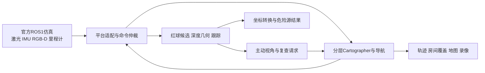

# HazardWalker

HazardWalker在官方ROS1 Noetic / Gazebo Classic / Unitree A1仿真中，完成三层建筑逐房巡查、红色球体检测、三维定位、危险源结果输出和返航。业务节点运行在宿主ROS2 Jazzy，通过rosbridge接入官方平台。

本分支是**2026年9月10日旧冻结版的复用基线**：`final_root_cause_validation_once`。算法与参数来自当时的成功版本，整理日期为2026年10月27日，适合复用分层SLAM、RGB-D检测、主动复查和ROS1/ROS2集成流程。

## 获取代码

```bash
git clone --branch release/stable-20260910 --single-branch https://github.com/Snowed-night/HazardWalker.git
cd HazardWalker
```

完整运行需要Git版本记录，请保留`.git`目录并使用上述克隆步骤。

固定发布版本与演示附件见[GitHub Release](https://github.com/Snowed-night/HazardWalker/releases/tag/stable-20260910)。

## 开始使用

完整仿真需要Ubuntu 24.04 x86_64、ROS2 Jazzy、Docker Compose，以及官方SimEnv镜像和运行资源。先按[环境准备](docs/guidebook/environment.md)安装依赖、导入官方资源，然后执行：

```bash
bash check.sh
bash build.sh
bash run.sh 202609102
```

`check`核对源码和环境；`build`构建六个ROS2包及ROS1控制器并运行离线检查；`run`才启动一次完整三层任务。代码和依赖不变时，再次实验只需`run`。历史完整任务的墙钟耗时约72—77分钟，取决于仿真实时倍率。

没有ROS环境时，可以先用Python 3.12审阅源码和运行离线检查：

```bash
python3 -m pip install -r requirements-offline.txt
bash check.sh --source-only
python3 scripts/run_offline_tests.py
python3 -m unittest discover -s tests/reproduction -v
```

详细命令见[快速开始](docs/guidebook/quickstart.md)，从连接服务器、构建到运行、观看和取回结果完整展开。

## 历史运行结果

| 场景种子 | 完成房间 | 正确目标 | 漏报 / 虚警 | 仿真耗时 | 历史客观分 |
| --- | --- | --- | --- | --- | --- |
| `20260728` | 12/12 | 4/4 | 0 / 0 | 908.119秒 | 32/37 |
| `202609102` | 12/12 | 3/3 | 0 / 0 | 855.479秒 | 33/37 |

这两个用例证明了对应场景的完整链路。旧版在其它种子中出现过漏检、停滞和倒地，不能由此推断任意场景均成功。[实验记录](docs/experiments/stable-20260910.md)给出来源及验证范围。2026年10月27日完成旧提交包重新构建及586项离线检查；当日新增完整实验因共享服务器占用尚未启动。

## 系统组成



| 路径 | 内容 |
| --- | --- |
| `ros2_ws/src/hazardwalker_platform` | 官方平台源码、Docker、数据适配和命令仲裁 |
| `ros2_ws/src/hazardwalker_nav` | 分层SLAM、逐房任务、局部导航、换层与返航 |
| `ros2_ws/src/hazardwalker_perception` | HSV候选、RGB-D几何、跟踪、主动观察与定位 |
| `ros2_ws/src/hazardwalker_decision` | 任务状态和危险源结果 |
| `ros2_ws/src/hazardwalker_msgs` | 消息定义 |
| `ros2_ws/src/hazardwalker_bringup` | 集成launch |
| `config` | 感知、坐标和任务参数 |
| `scripts/reproduction` | 本次整理的检查、资源导入、构建和启动入口 |
| `reproduction` | 冻结哈希、资源清单和历史结果摘要 |
| `tests/offline` | 原版离线检查 |
| `reports/perception` | 原检查所需的历史图像与记录 |

模块入口见[架构与接口](docs/guidebook/architecture-and-interfaces.md)，扩展步骤见[复用与开发](docs/guidebook/reuse-and-develop.md)。

## 适用范围

当前演示针对官方三层四房结构，使用门位和巡查顺序等结构参数。运行链包含平台提供的`/Odometry_gazebo`；目标高度使用楼层高度和已知球半径。这是固定仿真条件下的工程基线，不代表纯自估位姿、任意未知建筑或Go2/Go2-W实机能力。迁移实机时应替换平台输入、控制接口和坐标链，再验证误差与任务成功率。

红球识别使用HSV与深度几何；官方`.pt`文件是宇树运动策略。第三方依赖见[THIRD_PARTY_NOTICES.md](THIRD_PARTY_NOTICES.md)。

## 文档和许可

- [文档目录](docs/README.md)
- [运行与结果核验](docs/guidebook/run-and-results.md)
- [贡献方式](CONTRIBUTING.md)
- [Apache-2.0许可](LICENSE)；第三方目录保留各自许可。
