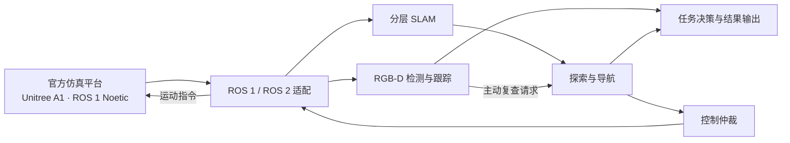

# HazardWalker

**面向多层建筑的四足机器人危险源自主搜索与识别系统**

[](https://github.com/Snowed-night/HazardWalker/actions/workflows/stable-offline.yml)


[](LICENSE)

HazardWalker 将分层建图、自主探索、RGB-D 目标识别与任务决策集成为一条完整运行链路。机器人在三层室内仿真建筑中逐房巡查，通过门和电梯完成跨区域移动，识别红色球体危险源、上报三维位置，并在任务结束后返回起点区域。

[快速开始](docs/guidebook/quickstart.md) · [环境配置](docs/guidebook/environment.md) · [架构与接口](docs/guidebook/architecture-and-interfaces.md) · [结果核验](docs/guidebook/run-and-results.md)

## 核心能力

- **多层自主巡查**：结合区域探索、房间覆盖和局部避障，组织开门、换层、房间检查及返航。
- **分层 SLAM**：为各楼层维护独立 Cartographer 会话，输出二维栅格地图、轨迹和连续性检查结果。
- **RGB-D 危险源识别**：利用颜色候选、深度几何和多帧跟踪确认红球，区分红色非球体干扰物。
- **主动观察**：将感知侧的复查请求传给导航，由导航完成视角调整与重观察。
- **统一控制与记录**：通过命令仲裁管理速度输出，自动保存目标坐标、房间覆盖、地图、视频与评分结果。

## 系统架构



业务节点运行于宿主机 ROS 2 Jazzy，官方 ROS 1 Noetic、Gazebo Classic 和 A1 控制器运行于 Docker。平台适配层统一传感器输入与控制接口，便于独立开发感知、导航和决策模块。

## 快速开始

完整仿真运行环境为 **Ubuntu 24.04 x86_64 + ROS 2 Jazzy + Docker Compose**。官方 SimEnv 镜像、运动策略和 SDK 运行库需预先准备，详见[环境配置](docs/guidebook/environment.md)。

```bash
git clone --depth 1 --branch main https://github.com/Snowed-night/HazardWalker.git
cd HazardWalker

# 导入已有官方 SimEnv 的运行资源
export OFFICIAL_SIMENV_SOURCE_ROOT=/absolute/path/to/official/SimEnv
export SIMENV_IMAGE=simenv_ros1:noetic-focal
python3 scripts/reproduction/prepare_assets.py --source "$OFFICIAL_SIMENV_SOURCE_ROOT"

bash check.sh
bash build.sh
bash run.sh 202609102
```

`check.sh` 检查源码及运行环境；`build.sh` 构建 ROS 1 / ROS 2 并运行离线测试；`run.sh` 启动一次完整三层任务。后续运行可直接调用 `run.sh`，结果默认写入 `reports/nav/`。完整命令、可视化和结果导出步骤见[快速开始](docs/guidebook/quickstart.md)。

### 离线测试

无需 ROS 或 Gazebo，可在 Python 3.12 环境下检查算法和接口：

```bash
python3 -m pip install -r requirements-offline.txt
python3 scripts/reproduction/verify.py --source-only
python3 scripts/run_offline_tests.py
python3 -m unittest discover -s tests/reproduction -v
```

## 项目结构

```text
HazardWalker/
├── config/                 # 感知、导航、坐标和任务参数
├── ros2_ws/src/
│   ├── hazardwalker_bringup/     # 系统启动与模块组合
│   ├── hazardwalker_platform/    # 官方仿真、平台适配与控制仲裁
│   ├── hazardwalker_nav/         # 建图、探索、局部导航与换层
│   ├── hazardwalker_perception/  # 红球识别、跟踪与三维定位
│   ├── hazardwalker_decision/    # 任务状态与结果输出
│   └── hazardwalker_msgs/        # ROS 消息与服务
├── scripts/                # 构建、启动、平台管理及结果核验
├── tests/                  # 核心算法与运行入口测试
├── reproduction/           # 源码与外部运行资源校验清单
├── docs/                   # 部署、接口和开发文档
└── check.sh / build.sh / run.sh
```

## 参考结果

以下为本项目基于 2026 年 9 月 10 日算法基线的历史完整仿真结果。

| 场景种子 | 巡查房间 | 正确识别 | 漏报 | 虚警 | 仿真耗时 | 客观分 |
| --- | ---: | ---: | ---: | ---: | ---: | ---: |
| `20260728` | 12 / 12 | 4 / 4 | 0 | 0 | 908.119 s | 32 / 37 |
| `202609102` | 12 / 12 | 3 / 3 | 0 | 0 | 855.479 s | 33 / 37 |

当前代码保留该基线的导航、感知与定位算法及运行参数。结果对应上述场景；新环境和新种子的表现需单独测量。运行后可使用[结果核验工具](docs/guidebook/run-and-results.md)检查房间覆盖、返航、SLAM 与目标匹配。

## 适用环境

当前实现面向官方三层建筑仿真，使用公开门位、楼层结构与 `/Odometry_gazebo` 位姿输入，目标高度结合楼层高度和球体半径计算。实机或其他建筑场景的接入方式见[复用与开发](docs/guidebook/reuse-and-develop.md)。

## 贡献与许可

欢迎通过 Issue 反馈问题，通过 Pull Request 提交改进。提交前请阅读[贡献指南](CONTRIBUTING.md)。

项目自有代码采用 [Apache-2.0](LICENSE) 许可。第三方源码、模型和运行资源遵循各自许可，详见 [THIRD_PARTY_NOTICES.md](THIRD_PARTY_NOTICES.md)。
